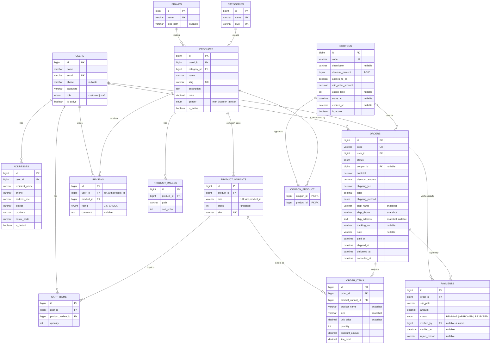

# Shoe Shop — Database Design

Database: **MySQL 8.4** (Laravel Sail). All tables use a `bigint unsigned` surrogate key `id`
and `created_at` / `updated_at` timestamps unless noted. Money columns are `decimal(10,2)`.

---

## 1. ER diagram



The framework tables created by the starter kit (`password_reset_tokens`, `sessions`, `cache`, `jobs`,
`passkeys`, …) are not part of the business model and are omitted.

---

## 2. EER: specialization of USER

```
                 USER
       (id, name, email, phone, password, is_active)
                  |
                 (d)      disjoint, total
               /     \
        CUSTOMER     STAFF
```

- **Disjoint** — a user is either a customer or a staff member, never both.
- **Total** — every user must be one of the two (no "plain" user).
- The subclasses have no extra attributes of their own; they differ only in the **relationships**
  they take part in: a CUSTOMER *has* addresses, cart items, orders and reviews; a STAFF member
  *verifies* payments.

**Mapping chosen — single relation with a type attribute** (option 8C in Elmasri & Navathe):
the specialization is stored in one table `users` with the discriminator column
`role ENUM('customer','staff') NOT NULL DEFAULT 'customer'`.

- `ENUM` + `NOT NULL` enforces *disjoint* + *total* at the database level.
- No joins are needed to authenticate or authorise a user.
- Since the subclasses have no specific attributes, there are no NULL-padded columns (the usual
  downside of this mapping).
- Registration always inserts `role = 'customer'`; staff can promote a user in the back office.
- Application side: `User::isStaff()` / `User::isCustomer()`, and the `staff` / `customer`
  route middleware.

---

## 3. Relational mapping

Notation: **PK** underlined as `PK`, foreign keys as `FK → table`.

| Relation | Schema |
|---|---|
| users | users(**id** PK, name, email UNIQUE, phone, password, role, is_active, email_verified_at, remember_token, two_factor_*) |
| addresses | addresses(**id** PK, user_id FK → users ON DELETE CASCADE, recipient_name, phone, address_line, district, province, postal_code, is_default) |
| brands | brands(**id** PK, name UNIQUE, logo_path) |
| categories | categories(**id** PK, name UNIQUE, slug UNIQUE) |
| products | products(**id** PK, brand_id FK → brands, category_id FK → categories, name, slug UNIQUE, description, price, gender, is_active) — INDEX(brand_id), INDEX(category_id) |
| product_images | product_images(**id** PK, product_id FK → products ON DELETE CASCADE, path, sort_order) |
| product_variants | product_variants(**id** PK, product_id FK → products ON DELETE CASCADE, size, stock, sku UNIQUE) — UNIQUE(product_id, size) |
| cart_items | cart_items(**id** PK, user_id FK → users ON DELETE CASCADE, product_variant_id FK → product_variants ON DELETE CASCADE, quantity) — UNIQUE(user_id, product_variant_id) |
| coupons | coupons(**id** PK, code UNIQUE, description, discount_percent CHECK 1–100, applies_to_all, min_order_amount, usage_limit, starts_at, expires_at, is_active) |
| coupon_product | coupon_product(**coupon_id, product_id** PK, coupon_id FK → coupons ON DELETE CASCADE, product_id FK → products ON DELETE CASCADE) |
| orders | orders(**id** PK, code UNIQUE, user_id FK → users, status, coupon_id FK → coupons ON DELETE SET NULL, subtotal, discount_amount, shipping_fee, total, shipping_method, ship_name, ship_phone, ship_address, tracking_no, note, paid_at, shipped_at, delivered_at, cancelled_at) — INDEX(status), INDEX(created_at) |
| order_items | order_items(**id** PK, order_id FK → orders ON DELETE CASCADE, product_variant_id FK → product_variants, product_name, size, unit_price, quantity, discount_amount, line_total) |
| payments | payments(**id** PK, order_id FK → orders ON DELETE CASCADE, slip_path, amount, status, verified_by FK → users ON DELETE SET NULL, verified_at, reject_reason) |
| reviews | reviews(**id** PK, user_id FK → users ON DELETE CASCADE, product_id FK → products ON DELETE CASCADE, rating CHECK 1–5, comment) — UNIQUE(user_id, product_id) |

### Relationships

| Relationship | Cardinality | How it is mapped |
|---|---|---|
| USER has ADDRESS | 1 : N | FK `addresses.user_id` |
| USER (customer) puts VARIANT in cart | M : N with attribute `quantity` | relation `cart_items` with UNIQUE(user_id, product_variant_id) so a variant appears once per cart |
| USER places ORDER | 1 : N | FK `orders.user_id` (RESTRICT: a user with orders cannot be hard-deleted) |
| USER writes REVIEW about PRODUCT | M : N with attributes `rating`, `comment` | relation `reviews` with UNIQUE(user_id, product_id) = one review per user per product |
| USER (staff) verifies PAYMENT | 1 : N, optional | nullable FK `payments.verified_by` |
| BRAND makes PRODUCT | 1 : N | FK `products.brand_id` (RESTRICT) |
| CATEGORY groups PRODUCT | 1 : N | FK `products.category_id` (RESTRICT) |
| PRODUCT has IMAGE | 1 : N | FK `product_images.product_id` (CASCADE — weak entity) |
| PRODUCT comes in VARIANT (size) | 1 : N, total on variant | FK `product_variants.product_id` (CASCADE) |
| COUPON applies to PRODUCT | **M : N** | junction relation **`coupon_product`** with composite PK (coupon_id, product_id) |
| ORDER uses COUPON | N : 1, optional | nullable FK `orders.coupon_id` (SET NULL so history survives deleting a coupon) |
| ORDER contains VARIANT | M : N with attributes | relation `order_items` (quantity + snapshots + discount) |
| ORDER is paid by PAYMENT | 1 : N | FK `payments.order_id` — several attempts are possible when a slip is rejected |

### Design decisions

- **`product_variants` separated from `products`** — one shoe model is sold in many sizes and each
  size has its own stock and SKU. Keeping size/stock in `products` would repeat name, price,
  description… for every size (violates 2NF/3NF and causes update anomalies).
  `UNIQUE(product_id, size)` prevents duplicate sizes.
- **Snapshots in `order_items`** (`product_name`, `size`, `unit_price`) — a past order must keep the
  price the customer actually paid even if the product is renamed or repriced later. This is a
  deliberate, controlled redundancy for historical correctness, not a normalization error.
- **Shipping address snapshot in `orders`** (`ship_name`, `ship_phone`, `ship_address`) instead of an
  FK to `addresses` — the customer may edit or delete an address later; the order must still show
  where it was shipped. `ship_address` is NULL for `PICKUP`.
- **Order totals stored** (`subtotal`, `discount_amount`, `shipping_fee`, `total`) — same reason;
  coupons and shipping rules can change after the order is placed.
- **`role` on `users`** — single-table mapping of the EER specialization (see section 2).
- **`coupon_product`** — the M:N relationship between coupons and products. A coupon with
  `applies_to_all = true` needs no rows here.
- **Products that were ordered are never hard-deleted** — `order_items.product_variant_id` is
  RESTRICT, so the back office sets `products.is_active = false` instead.
- **CHECK constraints** — `reviews.rating BETWEEN 1 AND 5`, `coupons.discount_percent BETWEEN 1 AND 100`
  (MySQL 8.0.16+ enforces CHECK).

### Integrity in the application layer

- **Checkout transaction** (`App\Services\CheckoutService::placeOrder`) runs in `DB::transaction()`:
  `SELECT … FOR UPDATE` on every variant in the cart → abort if `stock < quantity` → decrement stock →
  insert order + order_items → delete cart_items. Nothing is saved when any step fails.
- **Cancelling** (`App\Services\OrderService::cancel`) locks the order and restores stock in a transaction.
- **Status transitions** are defined in one place: `App\Enums\OrderStatus::canTransitionTo()`.
- **Coupon usage** = `COUNT(orders WHERE coupon_id = ? AND status <> 'CANCELLED')`, compared with `usage_limit`.

---

## 4. Extra features and the tables/columns they use

| Extra feature (requirement) | Tables / columns added |
|---|---|
| Coupon % discount on selected products | `coupons`, `coupon_product` (M:N), `orders.coupon_id`, `orders.discount_amount`, `order_items.discount_amount` |
| Comments / Reviews | `reviews` (`comment`), UNIQUE(user_id, product_id) |
| Rating 1–5 | `reviews.rating` (CHECK 1–5); average via `AVG(rating)` / `withAvg('reviews', 'rating')` |
| Admin dashboard (users, products, orders) | `users.role`, `users.is_active`, `payments.verified_by`, `payments.verified_at`, `payments.reject_reason`, `orders.tracking_no`, status timestamps (`paid_at`, `shipped_at`, `delivered_at`, `cancelled_at`) |
| Sales report | No new table — aggregate queries over `orders ⋈ order_items ⋈ product_variants ⋈ products ⋈ brands/categories` in `app/Services/SalesReportService.php` |

### Sales report queries (`app/Services/SalesReportService.php`)

Only orders with status in (`PAID`, `PREPARING`, `SHIPPED`, `DELIVERED`) inside the date range count.

```sql
-- Summary
SELECT SUM(total), COUNT(*), AVG(total), SUM(discount_amount)
FROM orders
WHERE status IN ('PAID','PREPARING','SHIPPED','DELIVERED')
  AND created_at BETWEEN :from AND :to;

-- Revenue per day
SELECT DATE(created_at) AS day, SUM(total) AS revenue
FROM orders WHERE … GROUP BY DATE(created_at) ORDER BY day;

-- Top 10 products by quantity sold
SELECT p.id, p.name, b.name AS brand,
       SUM(oi.quantity) AS quantity,
       SUM(oi.line_total - oi.discount_amount) AS revenue
FROM orders o
JOIN order_items oi      ON oi.order_id = o.id
JOIN product_variants pv ON pv.id = oi.product_variant_id
JOIN products p          ON p.id = pv.product_id
JOIN brands b            ON b.id = p.brand_id
WHERE o.status IN (…) AND o.created_at BETWEEN :from AND :to
GROUP BY p.id, p.name, b.name
ORDER BY quantity DESC
LIMIT 10;

-- Revenue by brand / by category: same joins, GROUP BY brands.id / categories.id
```
